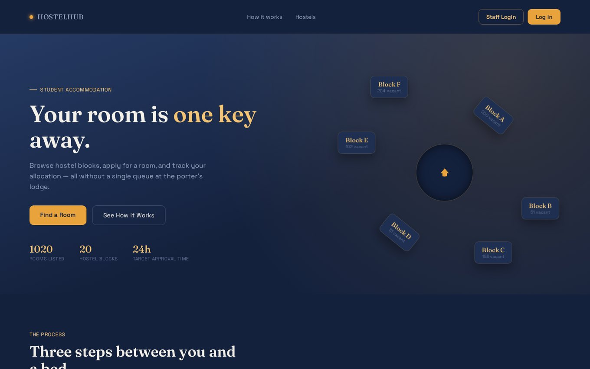
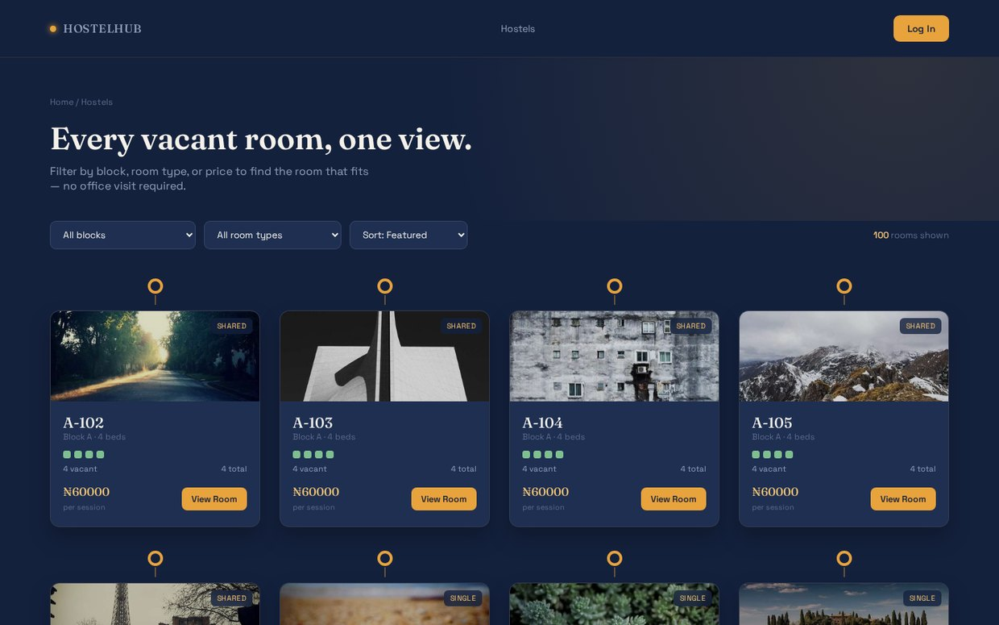
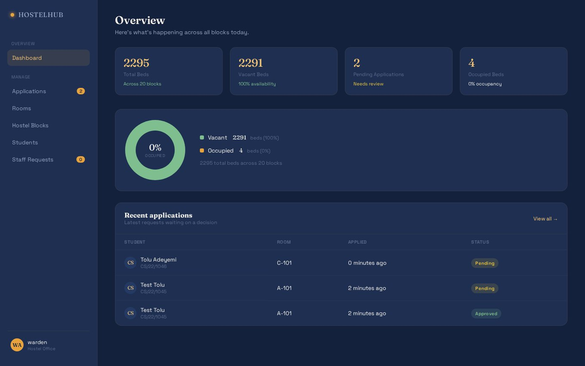

# HostelHub

A self-service room portal for a 20-block student hostel — browse vacancies, apply for a bed, and let the admin approve it.

Built with Django 6.1. No queues at the porter's lodge, no paper forms, no "come back tomorrow".


---

## What it does

| | |
|---|---|
| **Browse** | Every room with at least one free bed, filtered and searchable by hostel block |
| **Apply** | One active application per student, with session year and special requests |
| **Track** | Live status on the student dashboard: `pending` → `approved` / `rejected` |
| **Decide** | Admin approves or rejects applications, with capacity enforced on approval |
| **Onboard staff** | Anyone can request admin access; the account stays locked until an existing admin approves it |
| **Complaints** | Students report problems (6 categories) and watch the trail; admins run each one through Reported → In Review → Assigned → In Progress → Resolved → Closed, with notes fed back to the student |
| **Block contacts** | Real supervisor names/phones (with assistants) on every room page, managed in the data admin — the placeholder cards they replaced were hardcoded HTML |

The inventory is real, not mocked: 20 hostel blocks × 51 rooms = **1,020 rooms / 2,295 beds**, seeded by a management command and computed live from the database in the admin overview.

---

## Quick start

```bash
git clone https://github.com/Viod-01/HostelHub.git
cd HostelHub/myproject

python -m venv .venv && source .venv/bin/activate   # Windows: .venv\Scripts\activate
pip install -r requirements.txt

python manage.py migrate
python manage.py seed_rooms                          # creates all 20 blocks; safe to re-run
python manage.py createsuperuser                     # your first admin account

python manage.py runserver
```

Open http://127.0.0.1:8000

> **Why `createsuperuser`?** Staff approvals are gated on `is_staff`. The first approved
> account has to come from somewhere, so bootstrap one superuser locally — after that,
> new admins come in through the "Request Access" flow instead.

### Environment

All settings are read through `python-decouple`, so a local `.env` works out of the box. Everything is optional — the app boots with SQLite and no config at all.

```ini
# myproject/.env  (git-ignored)
DEBUG=True
ALLOWED_HOSTS=127.0.0.1,localhost
SECRET_KEY=django-insecure-change-me-in-production-0123456789abcdef
DATABASE_URL=sqlite:///db.sqlite3
```

| Variable | Default | Notes |
|---|---|---|
| `DEBUG` | `False` | Set `True` for local development |
| `ALLOWED_HOSTS` | `127.0.0.1,localhost` | Comma-separated |
| `SECRET_KEY` | *(hardcoded fallback)* | Override this in production — see [Security](#security) |
| `DATABASE_URL` | `sqlite:///db.sqlite3` | Postgres via `dj-database-url`; `RENDER_EXTERNAL_HOSTNAME` is auto-appended to `ALLOWED_HOSTS` |

---

## Screens

**Rooms, per bed** — a 4-share shows exactly how many of its beds are still free, and the
listing only contains rooms that have one.


**Admin side** — occupancy across every block with pending applications and pending staff
requests in the same view, which is the half that makes it a product rather than a browse page.


---

## How the pieces fit

```
HostelHub/
└── myproject/
    ├── manage.py
    ├── requirements.txt
    ├── build.sh                      # Render build command
    ├── myproject/
    │   ├── settings.py               # env-driven config, Postgres/SQLite switch
    │   └── urls.py                   # all routes in one readable list
    └── portal/
        ├── models.py                 # Hostel, Room, StudentProfile, Booking, Complaint,
        │                             # ComplaintUpdate, BlockSupervisor, BlockAssistant,
        │                             # StaffAccessRequest
        ├── views.py                  # 18 views, permission enforced here
        ├── charts.py                 # dependency-free SVG line charts
        ├── tests.py + test_concurrency.py   # 56 tests (2 concurrency tests, Postgres-only)
        ├── admin.py                  # list_display / filters for every model
        ├── migrations/               # 9 migrations
        ├── management/commands/
        │   └── seed_rooms.py         # 20 blocks × 51 rooms, insert-only
        └── templates/hostel/         # 11 self-contained pages + a chart include
```

### Data model

```
Hostel (block)              Room                    Booking
├─ name                     ├─ hostel      ──FK──►  ├─ student     ──FK──► User
├─ room_type                ├─ room_number (uniq)   ├─ room        ──FK──► Room
│    single | shared |      ├─ floor                 ├─ session
│    self_contain |         └─ occupied_beds         ├─ status  pending|approved|rejected
│    two_bedroom                 ▲                   ├─ special_requests
├─ capacity_per_room               │                 └─ applied_at / decided_at
└─ price_per_session               │
                        StudentProfile ◄── 1:1 ── User
                        ├─ matric_number (uniq)      StaffAccessRequest
                        ├─ department / level        ├─ user        ── 1:1 ─► User
                        └─ phone                     ├─ staff_id (uniq)
                                                     └─ status  pending|approved|rejected
```

`Room.capacity`, `Room.vacant_beds` and `Room.is_full` are derived properties on the block's `capacity_per_room` — occupancy is stored as a single integer per room, which keeps the vacancy filter a cheap `WHERE occupied_beds < capacity_per_room` at the database level.

---

## The two decisions worth reading

### 1. One student, one active application

Deliberately treats `pending` *and* `approved` as active — a student with an application under review cannot spam a second room to improve their odds, and cannot hold two beds after approval. The view checks in Python for a friendly message, but the real guard is a **partial unique index** (`one_active_booking_per_student`) that makes the database itself refuse a second pending/approved row per student — a check-then-insert race (double-click, two tabs) is caught at the door and surfaced as the same friendly message.

### 2. Vacancy is checked twice, at the right moments

A student applying to a full room is bounced back to the listing (`room.is_full`), and an admin approving into a room that filled up while the application sat pending is refused with an explicit message. Beds are only claimed at approval — a pending application reserves nothing, so the vacancy you see on the listing page is genuinely available.

The decide itself runs inside `transaction.atomic()` with `select_for_update()` row locks on the booking *and* the room: two admins clicking Approve on the same millisecond (or on two applications for the last bed) queue up at the database instead of double-counting a bed, and a stale dashboard tab can't flip an already-decided application. The threaded tests in `test_concurrency.py` fire two simultaneous decisions at a real Postgres and assert the invariants; the old code fails exactly those two tests, the current code passes 11/11 of the decision-path suite.

### Self-service staff access, without a privilege-escalation hole

This is the part I'd most want someone to review. An applicant on the admin login page creates a real `User` row immediately, but with `is_active=False` and `is_staff=False`:

```python
user = User.objects.create_user(
    username=staff_id, email=email, password=password, is_active=False,
)
```

Because Django's `authenticate()` already refuses inactive users, the lockout is free — no custom gate, no view-level flag to forget. Only `staff_request_decision("approved")` flips `is_active` and `is_staff` together. A rejected request stays on record but can't sign in anywhere, student side included.

Login failures on the staff page return one generic message whether the account doesn't exist, the password is wrong, or a real account just isn't staff — so the form can't be used to probe which staff IDs are registered.

---

## Routes

| Path | View | Access |
|---|---|---|
| `/` | `landing` | public |
| `/hostels/` | `listing` | public — rooms with a free bed only |
| `/hostels/<room_number>/` | `detail` | public (shows your status if logged in) |
| `/login/`, `/register/submit/` | `login_register`, `login_view`, `register_view` | public |
| `/dashboard/` | `dashboard` | `@login_required` |
| `/hostels/<room_number>/apply/` | `booking` | `@login_required` |
| `/logout/` | `logout_view` | public |
| `/admin-login/` + `/submit/` + `/request/` | staff login & access request | public |
| `/dashboard/admin/` | `admin_dashboard` | `@staff_member_required(login_url='admin_login')` |
| `/dashboard/admin/bookings/<id>/<decision>/` | `booking_decision` | staff only |
| `/dashboard/admin/staff-requests/<id>/<decision>/` | `staff_request_decision` | staff only |
| `/dashboard/complaints/` | `complaints_page` | `@login_required` — report + track |
| `/dashboard/admin/complaints/` | `complaint_list` | staff only |
| `/dashboard/admin/complaints/<id>/` | `complaint_detail` | staff only — the pipeline |
| `/admin/` | Django built-in admin | staff only |

Authentication is split by role at the view layer: a staff account signing in through the *student* form is rejected with a pointer to the admin page, so the two entry points can't be mixed.

---

## Deployment

The project is set up for [Render](https://render.com) — `build.sh` is the build command:

```bash
pip install -r requirements.txt
python manage.py collectstatic --no-input
python manage.py migrate
python manage.py createsuperuser --noinput || echo "NOTE: DJANGO_SUPERUSER_* not set - no admin created"
python manage.py seed_rooms
```

Configure on the host: `SECRET_KEY`, `DEBUG=False`, `DATABASE_URL`, `ALLOWED_HOSTS`.

`createsuperuser --noinput` only works if `DJANGO_SUPERUSER_USERNAME`, `DJANGO_SUPERUSER_EMAIL` and `DJANGO_SUPERUSER_PASSWORD` are all set as environment variables — otherwise it is skipped (with a note in the build log, not silently), and the first admin must be created by running `createsuperuser` against the production database.

Static files are served by WhiteNoise and `python manage.py check --deploy` is clean apart from the `SECRET_KEY`-length warning (it fires on any throwaway dev key, including the ones used above).

> **Rotate the old key.** `SECRET_KEY` was committed as a literal until recently, so the
> previous value must be treated as public: it can forge signed cookies and session data.
> It now reads from the environment with a dev-only fallback, so set a fresh one on the host.

---

## Known limitations

Stated plainly, because a portfolio project is more credible for them than without them:

- **No password reset or profile editing.** A forgotten password has no self-service path; the only recovery is editing `auth_user` in Django admin. The login page no longer offers a `Forgot password?` link for it — build the flow before restoring the control.
- **Photos are `picsum.photos` placeholders**, resolved at runtime by a third party. (The favicon, at least, is now real and locally served.) Swap in real block photography before showing this to anyone who might take the images literally.
- **A room holds beds, not people.** `occupied_beds` is an integer; nothing links an approved booking to a specific bed, and there is no move-out or cancellation path that releases one.
- **Booking decisions have no author.** `Booking` records `decided_at` but not which admin approved (complaint updates do record their author), so the booking audit trail is incomplete.
- **The admin dashboard's sections are client-side tab switches** (`showView(...)`) rather than real routes — fine at this size, but it means no deep links and no per-section caching.
- **Rejection is terminal.** A rejected student must register a fresh account to reapply, and the rejected application stays on their dashboard.

### Fixed in the current history

Worth listing because each was a live bug, not a code-smell, and the fixes are in `git log`:

- `Room.room_number` was `unique=True` in the model but **the constraint never reached the schema** — the initial migration omitted it. Two rooms sharing a number made `detail()`/`booking()` raise `MultipleObjectsReturned` (HTTP 500), since both look rooms up by number with `.get()`.
- `register_view` wrote `User` and `StudentProfile` in two unguarded steps, so a failure between them left an **active account that could log in, 404 on every page, and could never re-register** (its matric number was taken). Now wrapped in `transaction.atomic()` with `level` and `matric` validated first.
- `whitenoise` was installed but absent from `MIDDLEWARE`, so `/static/` was 404 in production; and `STATICFILES_STORAGE` was a **no-op since Django 5.1 removed it**, leaving `STORAGES` on the plain default.
- `seed_rooms` force-saved `price_per_session`/`capacity_per_room` on every block, and `build.sh` runs it on **every deploy** — so edits made in the data admin were silently reverted on the next push. It is now insert-only.
- `request_access` never checked email uniqueness, while `admin_login_submit` resolves identifiers via `filter(email=...).first()` — two staff requests sharing an email could authenticate against the first account.
- `admin_login.html` rendered its own generic text instead of the view's messages, so every rejection on the staff page said the same thing.
- `landing()` ran no query, so the hero counts and per-block "vacant" chips were **hardcoded HTML** that would not change as rooms filled. They are computed now; the "24h" figure is labelled as a target, because nothing measures actual decision latency yet.
- The staff login page had the same hardcoded stats plus a `Forgot password?` link to `#` and a "Keep me signed in" checkbox with no backend — both removed rather than left as dead furniture, since no password-reset flow exists yet.
- `admin_login_page()` loaded all 1,020 `Room` rows into Python to compute two numbers for an unauthenticated page; now one aggregate (2 queries).
- A Django gotcha worth remembering: **`{# comment #}` only works on one line.** A multi-line `{#` … `#}` is *not* stripped and renders as visible text on the page. Two comments I added did exactly that.
- `Complaints` was dead in **three** more templates (`booking`, `details`, `dashboard`) after being removed from two — plus a no-op "Edit Profile" button. All gone; no `href="#"` link that looks actionable remains in the portal.
- Two nav bugs: `listing.html` had two independent `` blocks that drew "Log In" twice for guests, and `landing.html` showed it to signed-in students. The dead `Complaints` link (no model, view or URL behind it) is gone.
- The **booking approval race** named above: decide inside `transaction.atomic()` with `select_for_update()` locks and a status re-check under the lock. The stale-tab fix alone closed a live bug nobody had clocked — a late Approve could resurrect a *rejected* application as approved, leaking a permanently-occupied bed with no release path.
- The listing shipped **~1,020 cards (~1 MB) and filtered them in the browser**; now the database filters and sorts, and `Paginator` serves 24 per page with the filters carried across pages.
- **Complaints, end to end**: model + pipeline (Reported → … → Closed), update trail with notes the student sees, assignment to block supervisors, staff-only management pages.
- The admin dashboard's "Block supervisors" cards were **hardcoded placeholder HTML** (fake names, `080X XXX` numbers) — replaced by real `BlockSupervisor`/`BlockAssistant` models, shown on room pages where students actually need them.
- **Row-Level Security** enabled on every table via migration — Supabase's auto-generated REST API is deny-by-default while Django (table owner) is untouched; verified 19/19 tables on a fresh database and the full suite against an RLS-enabled non-superuser Postgres.
- Failed-login errors were queued in the session but never rendered by the login template, so they **surfaced on the dashboard after a successful login** ("wrong password" shown to a signed-in user). The template reads the real messages now, and the success path drains the queue.
- Every page computed the avatar initials its own way — the dashboard showed name initials while the complaints page showed the first two characters of the **matric number**. One context processor feeds every page the same value now, pinned by test.

---

## Roadmap

- [x] `transaction.atomic()` + `select_for_update()` around approval, and a partial unique index enforcing one-active-booking-per-student at the DB level
- [x] Pagination or a server-side limit on the room listing — 24/page, filters server-side
- [x] Tests for the booking, registration and staff-access lifecycles, with GitHub Actions (56 tests; concurrency tests run only under Postgres and self-skip on SQLite)
- [ ] Move payments out of "price per session" text into an actual invoicing record
- [ ] Email notifications on approve/reject (`EMAIL_BACKEND` is currently the console backend) and a real password-reset flow
- [ ] Per-bed allocation so a shared room shows *which* bed is yours
- [ ] Split the admin dashboard's client-side views into real routes
- [ ] Record which admin decided each booking (complaints already do)

---

## Tech

**Django 6.1** · `dj-database-url` for SQLite/Postgres parity · `python-decouple` for env config · **gunicorn** + **WhiteNoise** for serving · vanilla HTML/CSS/JS templates with no build step, no CSS framework, and no client-side framework — the eleven pages are self-contained by design.

## License

Released under the MIT License.

